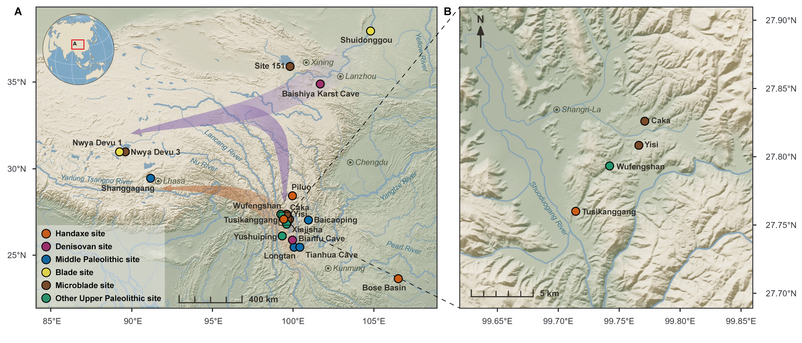
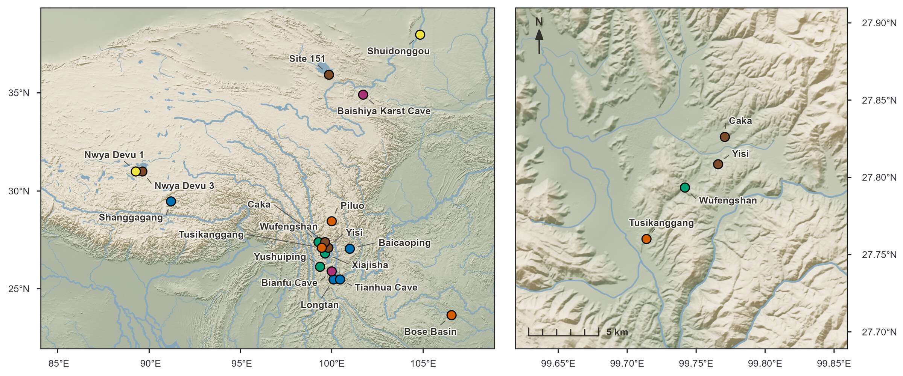

# Southeastern Tibetan Plateau: A nexus for high-altitude hominin adaptation and dispersal

This repository holds the R code for the site map in this review paper. Panel **A** shows Paleolithic sites across the central and eastern Tibetan Plateau and its eastern margin, and panel **B** shows the Shangri-La group in detail. Both panels are shaded-relief maps built with ggplot2 and terra. Each one is rendered at exactly its printed size and then assembled and annotated in Adobe Illustrator.



*The final figure. The arrows, place and river names, globe locator and zoom lines were added in Illustrator.*

## Contents

```
R/
  common.R          shared by both panels: palette, relief renderer, site symbols and
                    their packing, type sizes, map furniture, page fitting, layer export
  map_plateau.R     panel A: central and eastern Tibetan Plateau (Copernicus GLO-90)
  map_shangrila.R   panel B: the Shangri-La sites (Copernicus GLO-30)
data/
  sites.csv         the 18 sites: name, age (ka), coordinates as published, assemblage
assets/
  globe_locator.png the globe locator placed in panel A (made separately, not by the scripts)
figures/            images used in this README
```

The scripts also create `data/cache/` (downloaded and derived rasters) and `output/` (the maps). Git ignores both.

## Running

Install the packages once. WhiteboxTools traces the drainage in panel B:

```r
install.packages(c("sf", "terra", "tidyterra", "ggplot2", "ggspatial", "ggrepel",
                   "dplyr", "scales", "here", "ragg", "png",
                   "rnaturalearth", "rnaturalearthdata", "whitebox"))
whitebox::install_whitebox()
```

Open `SETP_site_map.Rproj`, or start R in the repository root, and run:

```r
source("R/map_plateau.R")                     # panel A, quick preview (200 dpi)
PREVIEW <- FALSE; source("R/map_plateau.R")   # panel A, final (600 dpi)
source("R/map_shangrila.R")                   # panel B, final (600 dpi)
```

The first run downloads its data and caches it in `data/cache/` (about 190 MB), which takes a while. Panel A reads the Copernicus GLO-90 tiles over HTTP, and GDAL warps them straight onto a 375 m grid. Panel B reads a few GLO-30 tiles, and the Natural Earth rivers and lakes are downloaded once. After that, each script takes about a minute or two.

Output, in `output/maps/`:

| File | Content |
|---|---|
| `map_plateau_sites_preview.png` | panel A, preview |
| `map_plateau_sites.png` / `.pdf` | panel A, complete |
| `map_inset_shangrila.png` / `.pdf` | panel B, complete |
| `map_<panel>_layer_base` / `_points` / `_labels` (`.png` / `.pdf`) | each panel as three registered layers (see below) |
| `map_plateau_legend.png`, `_north_arrow.png`, `_scalebar.png` | panel A's furniture as trimmed, transparent PNGs |

Tested with R 4.6.1, sf 1.1-2 (GDAL 3.12.1), terra 1.9-46, tidyterra 1.3.0, ggplot2 4.0.3, ggspatial 1.1.10, ggrepel 0.9.8, ragg 1.5.2 and whitebox 2.4.3. ggplot2 3.5 or later is required. `scalebar_grob()` calls two internal ggspatial functions, so a future ggspatial release could break it.

## Style notes



*The two panels as the scripts write them, placed edge to edge at 100 % (180 × 75 mm), before any hand editing.*

### Relief

- **Hypsometric tint on fixed elevation knots.** The tint runs from sage lowlands through sand to stone highlands, with knots at 0, 600, 1500, 2600, 3800, 4800 and 6200 m. Because the knots are fixed, a given elevation gets the same colour on any map. The ramp is blended 72 % toward a paper tone.
- **The hillshade changes the lightness of each pixel's own tint** (in HSL) rather than lying over it as a grey overlay. Lit faces move toward white by 42 % of their remaining headroom and shadows toward black by 38 %, so pale summits and dark gorges never clip. Lit faces also get a warm tint (`#FFF4E2`) and shadows a cool one (`#4C5A6B`).
- **Three light sources** at azimuths 300°, 337° and 15°, with the sun 35° above the horizon, averaged together.
- **Panel A** is shaded on a 375 m grid and then averaged 3 × 3 to about 1.1 km, roughly one printed pixel at 600 dpi, so it prints crisp and free of aliasing. Half of the shading comes from the averaged grid itself, to keep the broad modelling of the ranges.
- **Panel B** lies entirely between 3250 and 4480 m, which falls between two of the shared knots. It therefore spreads the same seven colours over local knots, so the same colour stands for different elevations in A and B.

### Colours

| Role | Hex |
|---|---|
| Hypsometric ramp, low → high | `#7E8E74` `#93A184` `#A9B195` `#BFBCA4` `#D1C9B3` `#DCD4C1` `#E6DECB` |
| Paper | `#E9E4D8` |
| Water | `#86A6BB` |
| Text | `#332F29` |
| Frame | `#202124` |

Each site is drawn as a black-ringed circle, and the fill shows only its assemblage class:

| Class | Fill |
|---|---|
| Handaxe site | `#D55E00` |
| Denisovan site | `#AA3377` |
| Middle Paleolithic site | `#0072B2` |
| Blade site | `#F0E442` |
| Microblade site | `#7B4B2A` |
| Other Upper Paleolithic site | `#009E73` |

The six fills come from six hue families: Okabe–Ito vermilion, blue, yellow and bluish green, Paul Tol's purple, and a dark brown. Any two of them can end up side by side on the map. The closest pair has an OKLab distance (ΔE × 100) of 16.3 for normal vision, 10.2 under deutan simulation and 8.4 under tritan simulation. Where symbols overlap, the class listed first is drawn on top.

### Crowded symbols

When sites lie closer together than a symbol's width on the page, they form a group. The group's symbols are laid out in a tight hexagonal cluster (one centre slot plus six around it) centred on the group's true centre. Each site takes the slot nearest its true bearing from that centre. The symbols overlap but each still shows a crescent, and coincident sites such as Nwya Devu 1 and 3 end up side by side. The console reports every shift (`displaced for legibility: …`).

### Print size and type

- **Every type size is set once, in points.** Site names and axis labels are 5.5 pt, and headings are 6–6.5 pt. Each panel is rendered at its printed size: together they are 180 mm wide and 75.17 mm tall, with a 4 mm gutter. Placed at 100 % and never rescaled, the two panels carry identical type, and their frames line up.
- **`fit_sheet()` sizes the page to fit.** It measures everything outside the map panel (axis text, ticks, margins) with the export device's own font metrics and gives the remaining height to the panel. The page is then exactly as wide as the panel and its labels need.
- **Degrees appear on the axes only**, with no graticule inside the panels. Panel B puts its latitudes on the right so that the gutter between the maps stays clear.

### Layers for Illustrator

Besides the complete panel, each script writes three files with the same page geometry:

- `_base`: relief, water, axes and frame
- `_points`: the site symbols, on a transparent background
- `_labels`: the site names as plain text, on a transparent background

Placed at (0, 0) at 100 %, the three files line up exactly. Panel A's legend, north arrow and scale bar are also written as separate PNGs at the same type sizes. The scale bar is computed for the printed panel width, so it stays true to scale.

## From script output to the final figure

In Illustrator, the `_base` and `_points` layers of both panels, panel A's scale bar and `assets/globe_locator.png` were placed at 100 %. The site names and the legend were set as text there, in the same wording the scripts use, and the names were positioned by hand. The arrows, city and river names, zoom box linking A and B, and panel letters were also added in Illustrator. The Illustrator file is not part of this repository.

## Data

- **Sites.** `data/sites.csv` was compiled for the paper from the original publications. Coordinates are kept as published, in three notations (D°M′S″, decimal degrees and D°M.mmm′), and `parse_coord()` reads all three. The file is UTF-8 with a byte-order mark so that Excel opens it correctly.
- **Elevation.** Copernicus DEM GLO-90 (panel A) and GLO-30 (panel B), read from the AWS Open Data buckets. *Produced using Copernicus WorldDEM-30 and WorldDEM-90 © DLR e.V. 2010–2014 and © Airbus Defence and Space GmbH 2014–2018 provided under COPERNICUS by the European Union and ESA; all rights reserved.*
- **Rivers, lakes and land.** [Natural Earth](https://www.naturalearthdata.com/) (public domain). The drainage in panel B is traced from GLO-30 with [WhiteboxTools](https://www.whiteboxgeo.com/).
- **Tibetan Plateau outline.** Optional and off by default; not included in this repository. Zhang Y., Li B. & Zheng D. (2014), *Datasets of the boundary and area of the Tibetan Plateau*, Global Change Research Data Publishing & Repository, [doi:10.3974/geodb.2014.01.12.V1](https://doi.org/10.3974/geodb.2014.01.12.V1). To use it, unpack the shapefile into `data/DBATP/` and set `show_tp_line <- TRUE` in `R/map_plateau.R`.

## Adapting it

- **Another region:** change `frame_ll` and `map_crs` at the top of the panel script. Check `hyps_knots` in `common.R` if the elevation range is very different.
- **Other sites:** edit `data/sites.csv`, and change `site_types` in `common.R` for different classes or colours.
- **Another figure size:** change `comp_width_mm`, `comp_height_mm` and the `pt_*` type sizes in `common.R`.
- **What is drawn:** toggles near the top of `map_plateau.R` control the labels, rivers, lakes, plateau outline and on-map legend, north arrow and scale bar.

## Citation

If you use the site compilation or the figure, please cite the paper: *Southeastern Tibetan Plateau: A nexus for high-altitude hominin adaptation and dispersal* (full reference to be added).

## License

The code is released under the [MIT License](LICENSE). The site compilation, the figure and the globe locator belong to the paper above. The Copernicus DEM and Natural Earth data remain under their own terms.
